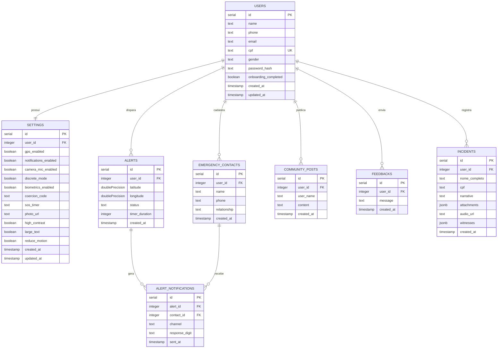

# DER — Diagrama Entidade-Relacionamento
## SOS Mulher

## Legenda de Status do Alerta

| Valor | Descrição |
|-------|-----------|
| `pending` | Alerta criado, aguardando envio |
| `sms_sent` | SMS/WhatsApp simulado enviado aos contatos |
| `calling_cloud` | Chamada em nuvem iniciada (Fase 2) |
| `voice_call_dispatched` | Chamada de voz Twilio despachada ao expirar o temporizador |
| `resolved_by_contact` | Contato respondeu com dígito "1" — situação segura |

## Canais de Notificação (alert_notifications.channel)

| Valor | Descrição |
|-------|-----------|
| `sms` | Notificação via SMS |
| `whatsapp` | Notificação via WhatsApp |
| `voice` | Chamada de voz automatizada |
